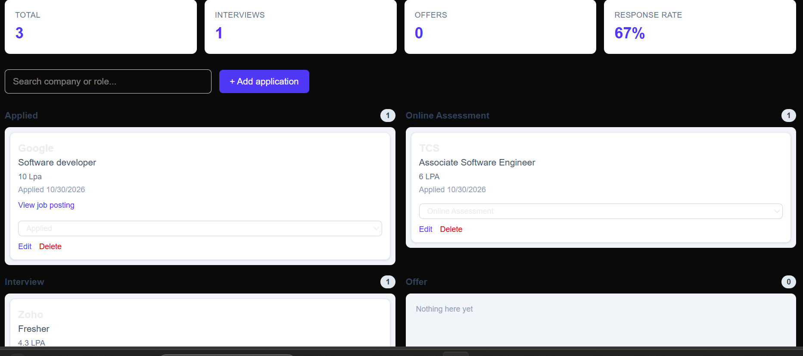
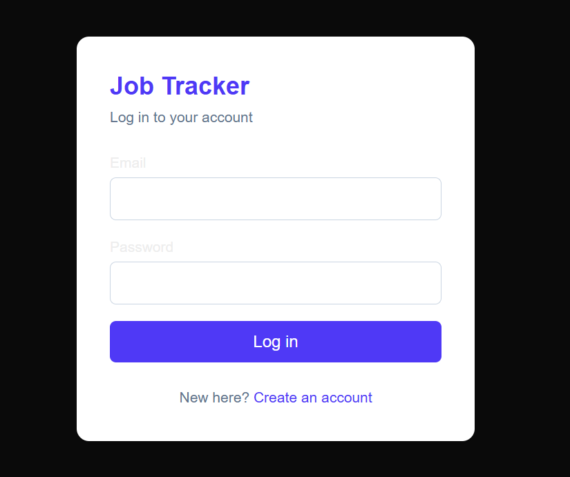
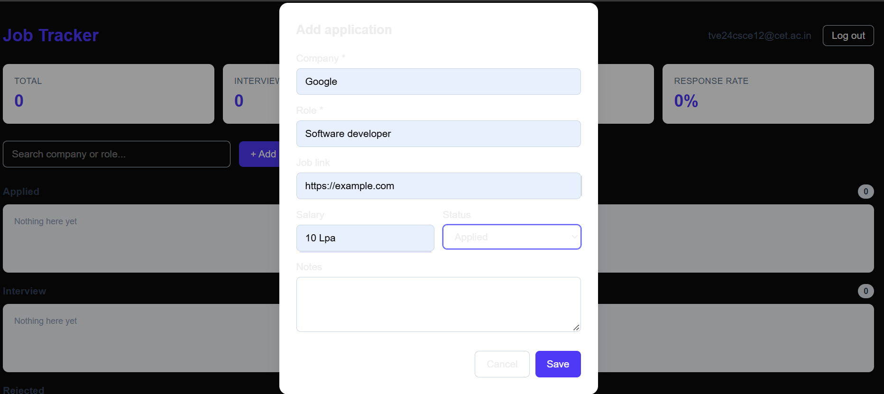
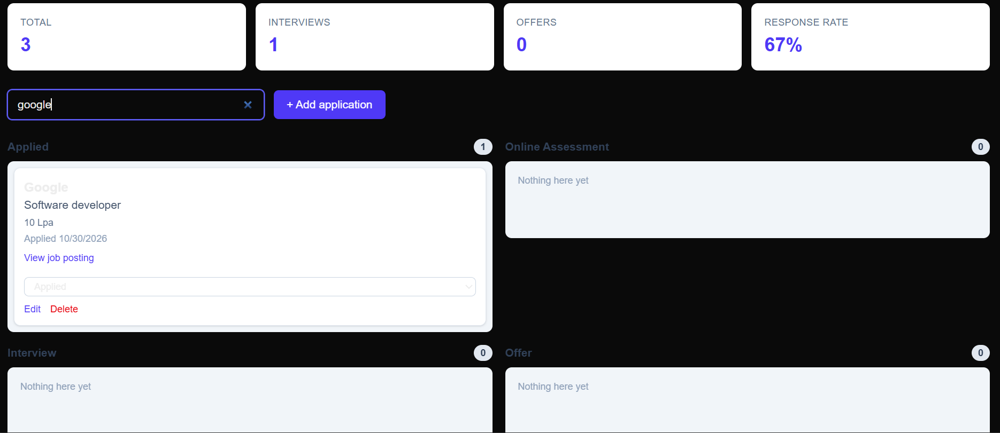
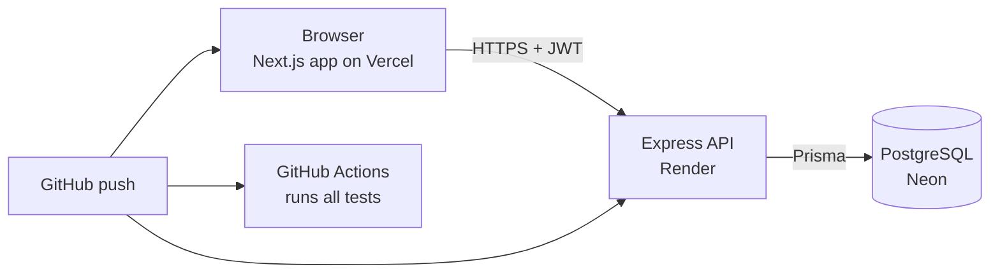

# Job Tracker

A full stack web app for tracking job applications on a Kanban board. Add applications, drag them through stages (Applied, Online Assessment, Interview, Offer, Rejected), search them, and see live stats.


**Live demo:** https://job-tracker-psi-rust-53.vercel.app

> The backend runs on a free hosting plan and sleeps after 15 minutes of inactivity. The first request after a quiet period can take up to a minute while it wakes up.



## Features

- Register, log in and log out with JWT access tokens and rotating refresh tokens
- Add, edit and delete applications (company, role, job link, salary, notes)
- Kanban board with **drag and drop** between status columns, plus a status dropdown for keyboard and touch users
- Search by company or role, with debounced requests
- Stats: total applications, interviews, offers and response rate
- Status history recorded for every change
- Each user can only see their own data

## Screenshots

| Login | Add application |
|---|---|
|  |  |



## Tech stack

| Layer | Tools |
|---|---|
| Frontend | Next.js (App Router), React, TypeScript, Tailwind CSS |
| Backend | Node.js, Express.js, TypeScript, Zod validation |
| Database | PostgreSQL with Prisma |
| Auth | JWT access token in memory, refresh token in an httpOnly cookie, bcrypt password hashing |
| Testing | Jest and Supertest (backend), Jest and React Testing Library (frontend) |
| DevOps | Docker and docker-compose, GitHub Actions CI, Vercel (frontend), Render (backend), Neon (database) |

## Architecture



## Key design decisions

- **Access token in memory, refresh token in an httpOnly cookie.** Scripts on the page cannot read the refresh token, which limits the damage from XSS.
- **Refresh token rotation.** Each refresh deletes the old token and issues a new one. Only a hash is stored in the database.
- **Authorization on every query.** All application queries include the user id, so one user can never read or change another user's data. A test covers this.
- **Optimistic UI for drag and drop.** The card moves immediately, then the server confirms. If the request fails, the board reloads the true state.
- **Separate test database.** Backend tests run against `jobtracker_test`, and the test setup refuses to run against any other database.

## API overview

| Method | Endpoint | Purpose |
|---|---|---|
| POST | `/api/auth/register` | Create account |
| POST | `/api/auth/login` | Log in |
| POST | `/api/auth/refresh` | New access token from the refresh cookie |
| POST | `/api/auth/logout` | Revoke refresh token |
| GET | `/api/auth/me` | Current user |
| GET | `/api/applications` | List with `search`, `status`, `sort`, `page`, `limit` |
| POST | `/api/applications` | Create |
| GET | `/api/applications/:id` | Get one with status history |
| PATCH | `/api/applications/:id` | Edit or change status |
| DELETE | `/api/applications/:id` | Delete |
| GET | `/api/stats` | Counts, response rate, applications per week |

## Run it locally

Requirements: Node.js 20+, Docker Desktop.

```bash
git clone https://github.com/krishna-priyakm/job-tracker.git
cd job-tracker
docker compose up --build
```

Open http://localhost:3000. Docker starts PostgreSQL, the API (port 4000) and the frontend (port 3000), and applies the database migrations automatically.

### Run the tests

Backend (needs the database running and a `jobtracker_test` database):

```bash
docker compose up -d db
cd server
npm install --legacy-peer-deps
npm test
```

Frontend:

```bash
cd client
npm install --legacy-peer-deps
npm test
```

## What I learned

- Designing a REST API with validation, pagination and per-user authorization
- How access tokens, refresh tokens and cookies work together, including cross-domain cookie settings (`SameSite=None; Secure`) for production
- Writing automated tests at both layers, and why tests need their own database
- Containerizing a multi-service app and running migrations on start
- Setting up CI so every push runs the test suites
- Debugging real deployment problems: CORS origins, environment variables and cold starts

## Possible next steps

- Follow-up reminders and a deadline view
- Resume upload with validation
- Status history timeline on each card
- Swagger API documentation